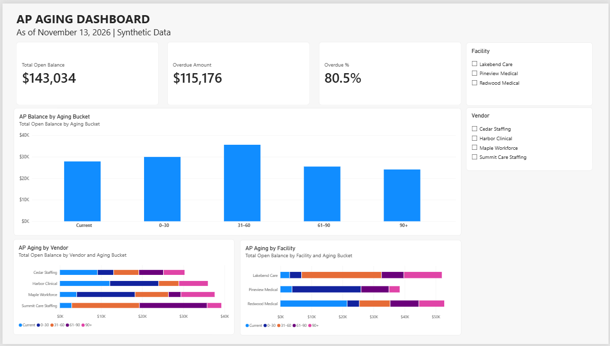
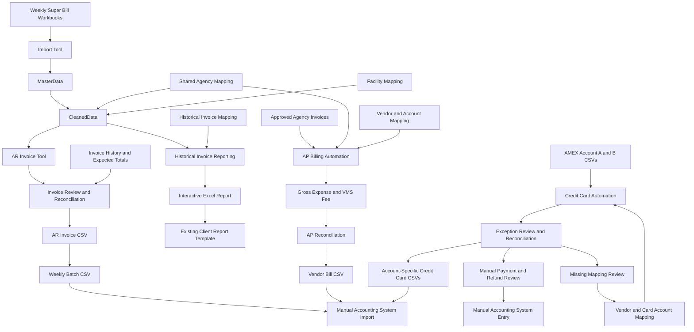

# Accounting Automation Portfolio

### Practical accounting workflow improvements using Python, Excel & GitHub Actions

A portfolio demonstrating how existing accounting workflows can be made more efficient, reliable, and easier to operate without replacing the underlying business process.

Based on real-world accounting improvements and recreated using entirely synthetic data, this project demonstrates accounts receivable automation, accounts payable automation, credit card transaction automation, billing data consolidation, quality control, and historical invoice reporting.

---

## Business Impact

### Real-World Workflow Improvements


| Area | Before | After |
|---|---|---|
| Accounts Receivable | Approximately 8 hours per weekly cycle | 2–3 hours |
| Accounts Payable | Approximately 2 hours per weekly cycle | Under 5 minutes |
| Credit Card Processing | Approximately 2 hours per monthly cycle | Approximately 30 minutes |
| Historical Invoice Reporting | Manual workbook and worksheet searches | Invoice-number-driven reporting |


### Accounts Receivable

Reduced weekly invoice processing time from approximately **8 hours to 2–3 hours**, including billing reconciliation, final review, and supporting PDF attachments.

Previously, invoices were created individually in the accounting system, with detailed billing information entered manually. The improved workflow consolidates billing data, prepares validated invoice records, and generates batch CSV files for import.

Essential accounting controls remain in place, including verification of supporting agency invoices, attachment completeness, and final invoice review.

### Accounts Payable

Reduced weekly vendor bill preparation and entry time from approximately **2 hours to under 5 minutes** through vendor-specific account mapping, automated VMS fee calculations, and batch CSV imports.

Previously, each vendor's historical bill was retrieved and copied individually in NetSuite to preserve the correct vendor-specific COGS account. Invoice numbers, dates, amounts, fees, and memos were then updated manually.

The improved workflow replaces those repeated searches and manual entries with standardized mapping tables and automated CSV generation.

### Credit Card Processing

Reduced monthly credit card transaction processing time from approximately **2 hours to 30 minutes** through reusable vendor and expense account mappings and automated CSV preparation for two AMEX accounts.

The original Excel workflow highlights missing vendor mappings and negative amounts, and provides an export check before saving the import file. Payments and refunds remain manual entries because they are not handled by the existing import process.

The Python demonstration adds separate exception reports, transaction count and amount reconciliation, and blocking of final export files when unresolved mappings remain.

### Historical Reporting

Replaced manual searches across weekly Super Bill workbooks with invoice-number-driven reporting using a centralized billing dataset.

### Data Quality

Introduced standardized agency selection through Excel Data Validation to prevent inconsistent data entry at the source, while retaining mapping controls for historical records and unexpected name variations.

All improvements were designed to preserve existing business workflows, accounting controls, and client reporting formats.

*Performance figures are approximate estimates based on the author's actual accounting workflow experience. This repository recreates the underlying automation concepts using synthetic data; the figures are not benchmark measurements of the Python demonstrations.*

---

## Financial Analysis & Visualization

### AP Aging Dashboard — Power BI

An interactive financial dashboard designed to support accounts payable analysis and management reporting in a healthcare staffing MSP/VMS environment.

- Total AP balance, overdue amount, and overdue percentage
- Aging analysis by vendor and facility
- Interactive facility and vendor filters
- NetSuite Saved Search data transformation using Power Query
- Reusable DAX measures

[View Power BI Dashboard Project](financial-dashboard/README.md)



---


## 1. Business Problem

Healthcare staffing accounting involves multiple staffing agencies, facilities, work weeks, billing rates, client invoices, and vendor bills.

Traditional workflows require repetitive manual tasks:

- Opening multiple weekly Excel workbooks.
- Searching for agency billing records and historical invoices.
- Copying and combining detailed billing information.
- Entering individual invoices and vendor bills into the accounting system.
- Looking up vendor-specific accounting information.
- Reconciling billing totals against approved amounts.
- Preparing supporting documents and client reports.
- Classifying credit card charges and preparing separate account imports.

These manual processes create opportunities for incorrect data entry, duplicate billing, missing information, inconsistent agency names, and time-consuming historical research.

The objective was to reduce repetitive administrative work while preserving accounting accuracy, source records, and existing business deliverables.

---

## 2. Design Philosophy

### Preserve the existing workflow

Automation should improve the work without unnecessarily disrupting the surrounding business process.

- Existing Super Bill workbooks remain the source of billing details.
- Existing invoice approval procedures remain in place.
- Existing accounting system import processes remain in place.
- Existing client reporting formats remain unchanged.
- Manual review is retained where accounting judgment is required.

### One data foundation, multiple business uses

Billing data is consolidated once and reused for multiple accounting functions.

The original source workbook and worksheet are retained for traceability. Generated outputs do not become additional independently maintained sources of billing information.

Approved agency invoice records remain a separate, controlled input for accounts payable and invoice reconciliation.

Shared reference information, such as agency name mapping, can be reused across AR and AP workflows.

### Automate repetition, not accounting judgment

The system automates extraction, transformation, calculation, reconciliation, and file preparation.

It does not replace the accountant's responsibility to validate contractual billing requirements, review exceptions, confirm supporting documents, and approve financial transactions.

### Prevent errors at the source

The real-world workflow also introduces Excel Data Validation for agency selection.

Standardized input reduces name variations before they enter the processing workflow. Mapping tables remain useful for historical data, external inputs, and defensive validation.

---

## 3. Before and After

| Business Task | Before | After |
|---|---|---|
| Weekly data consolidation | Open and combine Excel files manually | Automated workbook consolidation |
| Data updates | Recheck and recopy revised files | Hash-based detection and replacement |
| AR invoice preparation | Search records and enter invoice details individually | Select billing data and generate validated import files |
| AR reconciliation | Compare totals manually | Automated reconciliation with export prevention |
| AR batch processing | Create invoices individually | Generate a weekly batch CSV |
| AP vendor lookup | Find and copy a previous vendor bill | Retrieve vendor information from mapping tables |
| AP account selection | Preserve COGS accounts through historical bill copying | Automatically select vendor-specific COGS accounts |
| AP fee calculation | Enter VMS fee deductions manually | Automatically calculate the 5% fee |
| AP bill entry | Create and save each vendor bill | Generate a batch vendor bill CSV |
| Historical reporting | Search old workbooks and worksheets | Enter an invoice number to retrieve billing details |
| Client report preparation | Locate and copy historical source data | Generate report details and paste into the existing template |
| Agency data entry | Manually type agency names | Select standardized names using Data Validation |
| Credit card classification | Repeated vendor and expense account lookup | Reusable description-based mapping |
| Credit card import preparation | Manual transaction entry | Separate account CSVs with manual exception review |

---

## 4. System Architecture



### Architecture Notes

- AR and historical reporting reuse the consolidated billing dataset.
- AP processes approved agency invoice records rather than rebuilding payable amounts from clinical shift data.
- Agency mapping is shared across AR and AP.
- Credit card processing uses separate AMEX transaction inputs and vendor and card account mappings.
- Cardholders share their parent credit card account; individual names are retained in transaction memos.
- Historical invoice snapshots preserve the details billed at a particular point in time.
- Manual accounting system import and client report submission remain controlled steps.

The current repository demonstrates these components through separate runnable workflows. Some sample inputs are prepared independently for testing instead of being generated automatically by every preceding component.

---

## 5. Implemented Components

### A. Super Bill Import Tool

**Files:** `ImportTool.py`, `test_import.py`

Consolidates weekly Excel workbooks into structured datasets.

#### Features

- Direct XLSX import.
- Source file and worksheet traceability.
- File hash-based change detection.
- Incremental import of new workbooks.
- Replacement of imported records when a workbook changes.
- Support for records added, edited, or deleted in source workbooks.
- Facility and agency name standardization.
- Mapping quality control.
- Separation of normal timesheets and historical invoice snapshots.

The import process preserves supplied billing hour classifications and rates rather than enforcing one overtime pattern or fixed rate multiplier.

#### Outputs

- `MasterData.csv`
- `CleanedData.csv`
- `ImportLog.csv`
- `MappingQC.csv`

---

### B. AR Invoice Tool

**Files:** `InvoiceTool.py`, `test_invoice.py`

Extracts billing details for invoice preparation using the consolidated dataset.

#### Selection criteria

- Work Week Ending (WEO).
- Facility.
- One or more staffing agencies.
- Optional source worksheet selection.

#### Features

- Multiple-agency invoice extraction.
- Billing total calculation.
- Agency-level and overall billing summaries.
- Mapping validation.
- Exclusion of historical invoice snapshots from new invoice extraction.

#### Outputs

- `InvoiceRows.csv`
- `BillCheck.csv`

This stage reduces the need to search for and copy billing records across multiple workbooks.

---

### C. AR Reconciliation and ERP-Oriented Export

**File:** `NSMaster.py`

Combines invoice header information and billing summaries to prepare an accounting system import file.

#### Features

- Invoice number lookup.
- Customer, payment terms, invoice date, and service period retrieval.
- Unit-level billing summaries.
- REG, OT, DT, and additional billing line generation.
- Expected total versus calculated total reconciliation.
- Export prevention when amounts do not match.

#### Example

| Expected Total | Calculated Total | Result |
|---:|---:|---|
| $2,074.00 | $2,074.00 | Export allowed |
| $2,074.00 | $2,162.00 | Export blocked |

Invoice numbers are supplied through invoice history rather than independently generated by the export program.

#### Outputs

- `InvoiceHeader.csv`
- `Reconciliation.csv`
- `NetSuite_Import.csv`

---

### D. Weekly Batch Processing

**Files:** `WeeklyBatch.py`, `run_weekly_batch.py`, `test_weekly_batch.py`

Combines multiple validated invoices into a billing-date-specific CSV.

#### Features

- Multiple invoices in one batch.
- Reconciliation before adding an invoice.
- Duplicate invoice number detection within the batch.
- Explicit replacement of an existing invoice before import.
- Preservation of the existing batch when validation fails.
- Billing-date-specific output files.

#### Example output

`WeeklyBatch_2026-11-09.csv`

The demonstration verifies successful batch creation, rejected invoice additions, duplicate prevention, and controlled invoice replacement.

---

### E. Split-Shift Billing and Corrections

**Files:** `SegmentInvoice.py`, `run_segment_billing.py`

Demonstrates billing scenarios where one clinical shift contains multiple billing categories.

#### Supported examples

- Charge assignments.
- Charge and Preceptor assignments.
- Preceptor assignments.
- Multiple billing rates within one shift.
- Original invoices.
- Subsequent correction invoices.

A single shift may legitimately appear in multiple billing rows or invoice records.

The system therefore does not assume that a repeated Shift ID is automatically a duplicate billing error.

#### Example

| Billing Category | REG | OT | DT | Amount |
|---|---:|---:|---:|---:|
| ICU-CHARGE | 2 | 0 | 0 | $200.00 |
| ICU-CHARGE-PRECEPTOR | 4 | 0 | 0 | $432.00 |
| ICU-PRECEPTOR | 2 | 4 | 0 | $800.00 |
| Original Invoice | 8 | 4 | 0 | $1,432.00 |
| Subsequent DT Correction | 0 | 0 | 0.5 | $100.00 |

The original invoice and its subsequent correction remain separate billing records.

Correction billing hours represent the adjustment being invoiced and should not automatically be interpreted as additional hours worked.

---

### F. Historical Invoice Reporting

**Files:** `InvoiceReport.py`, `prepare_report_demo.py`, `build_report_excel.py`

Retrieves historical invoice details using the same consolidated billing dataset used for AR invoice preparation.

#### Historical invoice snapshots

Weekly Super Bill workbooks may contain:

- Normal agency billing worksheets.
- Correction worksheets.
- Historical invoice worksheets containing details billed at a specific point in time.

Historical invoice worksheets are retained in the source workbook and imported into the consolidated dataset.

Their recorded billing amounts are preserved for reporting rather than recalculated using current rates.

#### Invoice mapping

`billing/InvoiceMap.csv` associates historical worksheets with invoice numbers.

| Field | Purpose |
|---|---|
| File Name | Source Super Bill workbook |
| WEO | Original work week ending |
| Sheet Name | Historical invoice worksheet |
| Invoice Number | Client invoice identifier |
| Facility | Standard facility name |
| Submission Date | Invoice billing date |

The report generator matches the source file and worksheet name and validates the standardized facility.

#### Interactive Excel Report

The generated `InvoiceReport.xlsx` contains three worksheets:

- **Report:** Interactive report with a yellow invoice number input cell.
- **Data:** Prepared invoice detail records.
- **Invoice:** Historical invoice mapping.

Enter or select an invoice number in cell B1 to display the work week date range, facility, invoice details, agency, clinician identifier, unit, shift date, billing hours, and invoice total.

#### Example

| Invoice Number | Type | WEO | Rows | Total |
|---|---|---|---:|---:|
| DEMO-PV10004 | Original | 10/17/2026 | 3 | $1,432.00 |
| DEMO-PV10005 | Correction | 10/17/2026 | 1 | $100.00 |

Both invoices belong to the same original work week but represent different billing events.

The interactive report retrieves the correct historical records based on the invoice number.

Client report preparation remains a controlled manual step: the accountant copies the generated report into the existing client-required workbook and arranges invoice sections by WEO.

#### Outputs

- Full historical invoice detail data.
- Individual invoice detail CSVs.
- Client-facing report CSVs.
- Interactive Excel invoice report.

---

### G. AP Vendor Bill Automation

**Files:** `APBilling.py`, `test_ap_billing.py`

Generates vendor bill import records from approved agency invoices.

#### Business context

Different staffing agencies require different COGS accounts.

The original manual process retrieved and copied a previous NetSuite vendor bill for each agency to preserve the correct accounting configuration.

The improved process stores the vendor-specific accounting information in mapping tables, eliminating the need to repeatedly search historical bills.

#### Inputs

| File | Purpose |
|---|---|
| `ap/ApprovedAgencyInvoices.csv` | Approved agency invoice records |
| `mapping/AgencyMap.csv` | Shared agency name standardization |
| `ap/VendorMap.csv` | Vendor ID and accounting configuration |

The approved invoice list includes:

- Agency and facility.
- Vendor invoice number.
- Client invoice number.
- Internal reference numbers.
- Work week ending.
- Approved invoice amount.
- Approval date.

#### Vendor and account mapping

The vendor mapping provides:

- Vendor ID.
- Vendor-specific COGS Account ID.
- Payment Terms ID.
- AP Account ID.
- VMS Fee Account ID.

For example:

| Agency | Vendor ID | COGS Account | VMS Fee Account |
|---|---:|---:|---:|
| Cedar Staffing | 9001 | 5101 | 5201 |
| Harbor Clinical | 9002 | 5102 | 5201 |

All identifiers are fictional.

#### VMS fee processing

The demonstrated business rule applies a uniform **5% VMS fee** across agencies and facilities.

Each vendor bill is represented by two expense lines:

1. Gross agency invoice amount assigned to the vendor-specific COGS account.
2. Negative VMS fee assigned to the designated fee account.

The lines share the same External ID so that they represent one vendor bill.

#### Example

| Expense Line | Account | Amount |
|---|---|---:|
| Gross Agency Invoice | COGS 5101 | $2,074.00 |
| VMS Fee | Fee Account 5201 | -$103.70 |
| Net Payable | | $1,970.30 |

The gross expense and fee deduction are recorded separately rather than combining them into a single net expense amount.

#### Additional features

- Reuse of existing agency name mapping.
- Automatic vendor and account selection.
- Decimal-based fee calculations with cent rounding.
- External ID generation.
- Memo generation using invoice references and facility information.
- Duplicate vendor invoice detection within the current input batch.
- Missing agency and vendor mapping validation.
- Gross, fee, net payable, and CSV total reconciliation.
- Export prevention when input validation fails.

#### Demonstration results

| Metric | Result |
|---|---:|
| Vendor Bills | 4 |
| CSV Expense Lines | 8 |
| Gross Total | $5,456.00 |
| VMS Fee Total | -$272.80 |
| Net Payable | $5,183.20 |
| CSV Total | $5,183.20 |
| Reconciliation Difference | $0.00 |

#### Outputs

- `VendorBillSummary.csv`
- `APReconciliation.csv`
- `VendorBill_Import.csv`

The AP export is a synthetic ERP-oriented demonstration, not a certified production NetSuite import configuration.

---

### H. Credit Card Automation

**Files:** `CreditCard.py`, `test_credit_card.py`

Prepares account-specific credit card transaction CSV files for two AMEX accounts while preserving manual accounting review and exception handling.

#### Inputs

| File | Purpose |
|---|---|
| `credit-card/AMEX_Account_A.csv` | Synthetic transactions for AMEX Account A |
| `credit-card/AMEX_Account_B.csv` | Synthetic transactions for AMEX Account B |
| `credit-card/VendorMap.csv` | Vendor keyword, vendor ID, and expense account mapping |
| `credit-card/CardAccountMap.csv` | Parent credit card account ID and reference prefix |

#### Mapping and account structure

- Identify vendors by matching keywords in transaction descriptions.
- Retrieve the vendor and expense account internal IDs from reusable mappings.
- Assign transactions to the appropriate parent credit card account.
- Preserve individual cardholder names in the memo and line description.
- Generate account-specific transaction references.

Multiple cardholders can share one parent account. For example, `DEMO CARDHOLDER A1` and `DEMO CARDHOLDER A2` both map to fictional credit card account 2201, while their individual names remain visible in the transaction records. Account B maps to fictional account 2202.

#### Exception handling and quality controls

The original Excel workflow highlights missing vendor keys in purple and negative amounts in yellow. Its check button reports missing vendor keys, payment rows, and negative amount rows.

The Python demonstration follows the same accounting decisions and extends the controls:

- Route payment and negative amount transactions to a manual-entry review file before vendor mapping.
- Identify missing vendor keys or incomplete vendor mappings for accounting review.
- Validate the source credit card account and check generated vendor and expense account IDs.
- Check for payments, negative amounts, and duplicate references in the generated export.
- Reconcile source transaction counts and signed amounts against import candidates, manual-entry transactions, and unresolved mappings.
- Block final import files for both accounts if either account has unresolved mapping errors or fails reconciliation or export validation.

Payments and refunds are intentionally not imported. Accounting reviews those transactions and records them manually. New vendors require accounting judgment before a mapping is added; subsequent transactions can reuse the approved mapping.

#### Demonstration results

| Metric | Account A | Account B |
|---|---:|---:|
| Source transactions | 6 | 6 |
| Source total | -$304.52 | -$2.76 |
| Import transactions | 4 | 4 |
| Import amount | $220.48 | $377.24 |
| Manual entry transactions | 2 | 2 |
| Manual entry amount | -$525.00 | -$380.00 |
| Missing mappings | 0 | 0 |
| Reconciliation difference | $0.00 | $0.00 |
| QC status | PASS | PASS |

The 12 source transactions are accounted for as eight import transactions and four manual-entry transactions. A separate automated test introduces an unmapped vendor, verifies that exports are blocked, adds the mapping, and verifies that the corrected batch passes.

#### Outputs

- `AMEX_A_Import.csv`
- `AMEX_B_Import.csv`
- `MissingVendor_QC.csv`
- `ManualEntry_Review.csv`
- `CC_Reconciliation.csv`

The credit card export is a synthetic ERP-oriented demonstration. No live NetSuite import has been performed.

---

## 6. Quality Control and Data Integrity

| Control | Purpose |
|---|---|
| File hash comparison | Avoid repeated processing of unchanged files |
| Changed-file replacement | Avoid retaining obsolete imported records |
| Facility and agency mapping | Standardize inconsistent source names |
| Source traceability | Identify the original workbook and worksheet |
| Source type separation | Exclude historical snapshots from new AR invoice extraction |
| Numeric validation | Reject invalid billing values |
| AR amount reconciliation | Block mismatched invoice exports |
| AR batch duplicate detection | Prevent repeated invoice additions |
| Explicit batch replacement | Correct an invoice without retaining duplicate batch records |
| Historical invoice mapping validation | Reject ambiguous worksheet mappings |
| Facility validation | Prevent incorrect historical invoice assignment |
| Vendor account mapping | Select the appropriate COGS account |
| AP vendor invoice duplicate detection | Detect repeated vendor invoices within an input batch |
| VMS fee calculation | Apply consistent fee calculations and rounding |
| AP batch reconciliation | Verify gross, fee, net payable, and CSV totals |
| Credit card vendor mapping | Identify unmapped vendors and incomplete accounting IDs |
| Credit card account validation | Prevent transactions from being assigned to the wrong parent account |
| Credit card exception routing | Retain payments and refunds for manual entry |
| Credit card export validation | Check required mapping IDs, payment and negative amount exclusion, and batch reference uniqueness |
| Credit card reconciliation | Account for all source transactions and amounts before releasing exports |

### Human review remains essential

The real-world AR workflow retains manual review of supporting agency invoice PDFs, invoice amount verification, attachment completeness, exception handling, and final approval.

The credit card workflow also retains manual review of new vendor classifications and manual entry of payments and refunds.

Automation is intended to reduce repetitive entry and retrieval work, not eliminate the accountant's responsibility for financial accuracy.

---

## 7. Run the Demonstrations

The repository includes GitHub Actions workflows that generate downloadable demonstration artifacts.

### Quick Start

1. Open the repository's **Actions** tab.
2. Select a workflow below.
3. Select **Run workflow**.
4. Review the execution results.
5. Download the generated artifacts.

| Workflow | Demonstrates |
|---|---|
| Import Super Bill Demo | Excel consolidation, incremental updates, and mapping |
| Invoice Tool Demo | AR billing detail extraction |
| NS Master Demo | AR reconciliation and invoice CSV generation |
| Weekly Batch Demo | Multi-invoice processing and duplicate controls |
| Segment Invoice Demo | Split-shift billing summaries |
| Segment Billing Demo | Original and correction invoice generation |
| Invoice Report Demo | Historical mapping and interactive Excel reporting |
| AP Billing Demo | Vendor account mapping, VMS fees, reconciliation, and vendor bill CSV generation |
| Credit Card Automation Demo | Two AMEX accounts, vendor mapping, manual exceptions, reconciliation, and account-specific CSVs |

### Recommended Demo 1: Interactive Invoice Report

Run **Invoice Report Demo**.

Download the **Invoice-Reports** artifact and open `InvoiceReport.xlsx`.

Change cell B1 between:

- `DEMO-PV10004`
- `DEMO-PV10005`

The Excel report displays the appropriate historical invoice details, work week, and total.

Expected results:

- Original: 3 rows, $1,432.00.
- Correction: 1 row, $100.00.

### Recommended Demo 2: AP Billing Automation

Run **AP Billing Demo**.

Download the **AP-Billing-Results** artifact.

Open `VendorBill_Import.csv` and observe:

- Four vendor bills represented by eight expense lines.
- Different COGS accounts for Cedar and Harbor.
- A separate negative 5% VMS fee line for each bill.
- Matching External IDs for the two lines of each bill.

Open `APReconciliation.csv` to verify the net payable and CSV total of $5,183.20 with a $0.00 difference.

### Recommended Demo 3: Credit Card Automation

Run **Credit Card Automation Demo** (`credit-card-demo.yml`).

Download the **Credit-Card-Results** artifact.

- Open `AMEX_A_Import.csv` and `AMEX_B_Import.csv` to review four expense transactions per account and the corresponding vendor, expense, and credit card account IDs.
- Open `ManualEntry_Review.csv` to review four payment and refund transactions with source file and row references.
- Open `MissingVendor_QC.csv` to review unresolved vendor mappings (none in the baseline demo).
- Open `CC_Reconciliation.csv` to verify both accounts pass with a $0.00 difference.

The workflow also runs automated tests for account separation, cardholder preservation, vendor mapping, manual exception handling, reference uniqueness, and missing-mapping export blocking and recovery.

### Additional Control Demonstrations

Run **NS Master Demo** and **Weekly Batch Demo** to explore AR reconciliation and duplicate invoice controls.

Run **Import Super Bill Demo** to explore incremental imports and changed-file replacement.

---

## 8. Repository Structure

```text
accounting-automation-portfolio/
|
|-- raw/
|   Synthetic weekly Super Bill workbooks
|
|-- mapping/
|   Shared agency and facility mapping tables
|
|-- billing/
|   InvoiceHistory.csv
|   InvoiceInput.csv
|   InvoiceMap.csv
|   ShiftSegments.csv
|
|-- ap/
|   ApprovedAgencyInvoices.csv
|   VendorMap.csv
|
|-- credit-card/
|   AMEX_Account_A.csv
|   AMEX_Account_B.csv
|   VendorMap.csv
|   CardAccountMap.csv
|
|-- ImportTool.py
|-- InvoiceTool.py
|-- NSMaster.py
|-- WeeklyBatch.py
|-- SegmentInvoice.py
|-- InvoiceReport.py
|-- APBilling.py
|-- CreditCard.py
|
|-- run_weekly_batch.py
|-- run_segment_billing.py
|-- prepare_report_demo.py
|-- build_report_excel.py
|
|-- test_import.py
|-- test_invoice.py
|-- test_weekly_batch.py
|-- test_ap_billing.py
|-- test_credit_card.py
|
|-- .github/workflows/
|   GitHub Actions demonstration workflows
|   credit-card-demo.yml (Credit Card Automation Demo)
|
|-- README.md
```

Generated outputs include consolidated datasets, billing summaries, reconciliation results, accounting-system-oriented CSV files, credit card exception reports, and interactive Excel reports.

---

## 9. Development Approach

This project combines accounting expertise with AI-assisted software development.

### Accounting and workflow design

The project author is responsible for:

- Identifying repetitive accounting tasks and operational bottlenecks.
- Defining business requirements.
- Designing data flows and accounting controls.
- Maintaining compatibility with existing business processes.
- Determining which manual review steps must remain.
- Defining expected financial results and exception scenarios.
- Validating the generated outputs against practical accounting requirements.

### AI-assisted implementation

AI tools assist with:

- Python implementation.
- Excel report generation.
- Automated test development.
- GitHub Actions configuration.
- Debugging and code refinement.
- Technical documentation.

The accounting requirements, workflow design, and validation decisions are driven by the project author.

The original workflow improvements were developed and used in actual accounting operations. This repository is a separate, synthetic reconstruction for professional portfolio purposes.

---

## 10. Technology

- Python 3
- Excel / XLSX
- CSV
- openpyxl
- Decimal-based financial calculations
- File hashing
- GitHub Actions
- Automated regression tests

Most core processing uses the Python standard library. The openpyxl library is used for preparing demonstration workbooks and generating interactive Excel reports.

---

## 11. Current Scope and Limitations

This repository is a portfolio demonstration, not a production accounting system.

- All sample workbooks, organizations, identifiers, rates, and amounts are fictional.
- GitHub Actions runs use isolated execution environments.
- Historical snapshots are prepared during demonstration runs without modifying the committed source workbook.
- Weekly batch persistence across separate workflow runs is not currently implemented.
- Split-shift examples use a separate sample dataset.
- AR and AP amounts are independently supplied; matching sample amounts do not imply that customer billing and vendor payable amounts must be equal.
- AP duplicate checks apply to the current input batch and do not query historical transactions in NetSuite.
- Credit card payments and refunds are reported for manual entry, not automatically posted.
- Credit card reference validation is limited to the generated batch; it does not detect transactions already imported into NetSuite.
- Credit card sample account numbers, cardholder names, vendor mappings, and internal IDs are synthetic. The two sample files represent parent accounts; production cardholder-specific card numbers and mappings are outside this demonstration.
- Credit card reconciliation accounts for source rows and signed amounts but does not independently verify the completeness of the original card statement or the correctness of accounting classifications.
- Full production NetSuite field mappings, including production-specific accounting and custom fields, are outside the current demonstration scope.
- Actual ERP import execution is not performed by the demonstrations.
- Client workbook insertion and final submission remain manual.
- Additional billing categories, such as holiday, missed meal, missed break, on-call, and callback, are not fully implemented.
- Excel Data Validation is a real-world source-data improvement described in this portfolio; the AP CSV demonstration focuses on processing and mapping the approved records.

The objective is to demonstrate workflow architecture, practical automation, and accounting controls rather than reproduce every production billing rule.

---

## 12. Roadmap

### Completed Demonstrations

- [x] Weekly Excel data consolidation
- [x] Incremental import and changed-file replacement
- [x] Facility and agency mapping
- [x] AR invoice detail extraction
- [x] AR invoice reconciliation
- [x] AR ERP-oriented CSV generation
- [x] Weekly invoice batching
- [x] AR duplicate invoice controls
- [x] Split-shift billing
- [x] Original and correction invoice separation
- [x] Historical invoice mapping
- [x] Interactive Excel invoice reporting
- [x] AP vendor bill automation
- [x] Vendor-specific COGS account mapping
- [x] Automated VMS fee processing
- [x] AP vendor invoice duplicate controls
- [x] AP reconciliation and CSV generation
- [x] Credit card transaction automation for two AMEX accounts
- [x] Credit card vendor and expense account mapping
- [x] Credit card payment and refund exception handling
- [x] Credit card export validation and reconciliation

### Next Milestones

- [ ] Unified end-to-end demonstration
- [ ] Additional documentation and regression tests

---

## 13. Data Privacy

All demonstration data is synthetic, including credit card transactions, cardholder names, account identifiers, and mapping records.

No employer workbooks, production credentials, confidential client information, or actual financial records are required to run this project.

The repository is intended for educational and professional portfolio purposes.

---

## Key Takeaway

Accounting automation does not always require replacing an existing system.

By consolidating source data, preserving historical billing records, standardizing reference information, automating repetitive entry, and retaining accounting review controls, existing workflows can become significantly easier to operate without disrupting the surrounding business process.

**Shared billing data. Reusable mappings. Multiple accounting workflows. Fewer manual steps. Stronger controls.**
