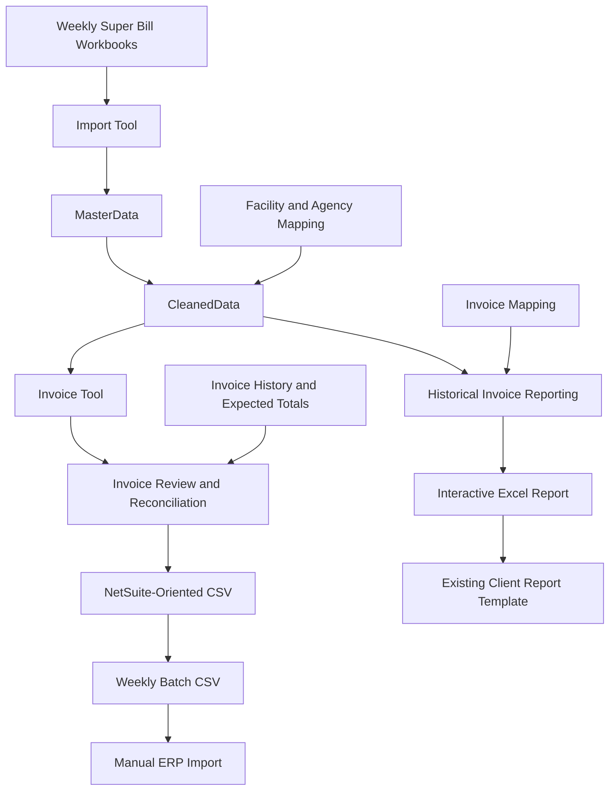

# Accounting Automation & Invoice Reporting

### A practical accounting workflow automation portfolio

An AI-assisted Python and Excel project demonstrating how existing accounting workflows can be made more efficient, reliable, and easier to operate without replacing the underlying business process.

This project is based on real accounting workflow improvements and has been recreated using entirely synthetic data for portfolio purposes.

**Current scope:** Accounts Receivable (AR), billing data consolidation, invoice quality control, batch CSV generation, and historical invoice reporting.

---

## 1. Business Problem

Weekly healthcare staffing billing involves multiple Excel workbooks, staffing agencies, facilities, work weeks, billing rates, and invoice records.

Traditional workflows require repetitive manual tasks:

- Opening individual weekly Super Bill workbooks.
- Searching for the correct agency or invoice worksheet.
- Copying and combining billing details.
- Reconciling invoice amounts against approved totals.
- Preparing invoice import files for the accounting system.
- Retrieving historical billing details for client reporting.

As billing volume increases, these tasks create opportunities for:

- Incorrect or missing billing information.
- Duplicate invoices.
- Incorrect facility or agency selection.
- Inconsistent data across separate files.
- Time-consuming historical invoice research.

The objective was to reduce repetitive work while preserving existing accounting controls, source workbooks, and client deliverables.

---

## 2. Design Philosophy

### Preserve the existing workflow

The original business process does not need to be replaced.

- Existing Super Bill workbooks remain the source.
- Existing invoice approval procedures remain in place.
- Existing accounting system import processes remain in place.
- Existing client reporting formats remain unchanged.
- Manual review is retained where accounting judgment is required.

The automation improves the work between these existing steps.

### One source, multiple business uses

Instead of maintaining separate manually edited datasets for each task, billing data is consolidated once and reused for multiple accounting functions.

The original source workbook and worksheet are retained for traceability.

Generated outputs are not additional independently maintained sources of truth.

### Automate repetition, not accounting judgment

The system automates data extraction, transformation, calculation, reconciliation, and file preparation.

It does not replace the accountant's responsibility to review billing exceptions, validate contractual rates, or approve invoices.

---

## 3. Before and After

| Business Task | Before | After |
|---|---|---|
| Weekly data consolidation | Open and combine multiple Excel files manually | Consolidate workbooks through an import process |
| Data updates | Recheck and recopy revised files | Detect changed files and replace their imported records |
| Invoice preparation | Search and copy selected billing rows | Select WEO, facility, agency, and source worksheet |
| Invoice reconciliation | Compare totals manually | Block CSV generation when totals do not match |
| ERP import preparation | Prepare invoice records individually | Generate a validated weekly batch CSV |
| Historical invoice reporting | Search old workbooks and invoice worksheets | Enter an invoice number to retrieve its billing details |
| Client report preparation | Locate, select, and copy historical data | Generate the report details and paste them into the existing client template |

The result is a workflow focused on review and exception handling rather than repetitive data retrieval and re-entry.

---

## 4. System Architecture



### Important distinction

The diagram represents the overall business workflow.

The current repository demonstrates its components through separate runnable workflows. Some sample inputs are prepared independently for testing rather than being produced automatically by every preceding component.

---

## 5. Implemented Components

### A. Super Bill Import Tool

**Files:** `ImportTool.py`, `test_import.py`

Consolidates weekly Excel workbooks into structured datasets.

Features:

- Direct XLSX import.
- Source file and worksheet traceability.
- File hash-based change detection.
- Incremental import of new workbooks.
- Replacement of imported records when a workbook changes.
- Support for source rows that have been added, edited, or deleted.
- Facility and agency name standardization.
- Mapping quality control.
- Separation of normal timesheet data and historical invoice snapshots.

Outputs:

- `MasterData.csv`
- `CleanedData.csv`
- `ImportLog.csv`
- `MappingQC.csv`

The import process preserves supplied billing hour classifications and rates rather than enforcing a single overtime pattern or fixed rate multiplier.

---

### B. Invoice Tool

**Files:** `InvoiceTool.py`, `test_invoice.py`

Extracts billing details for invoice preparation using the consolidated dataset.

Selection criteria:

- Work Week Ending (WEO).
- Facility.
- One or more staffing agencies.
- Optional source worksheet selection.

Features:

- Multiple-agency invoice extraction.
- Billing total calculation.
- Agency-level and overall billing summaries.
- Mapping validation.
- Exclusion of historical invoice snapshots from new invoice extraction.

Outputs:

- `InvoiceRows.csv`
- `BillCheck.csv`

This stage reduces the need to search and copy billing records across multiple workbooks.

---

### C. Invoice Reconciliation and ERP-Oriented Export

**File:** `NSMaster.py`

Combines invoice header information and billing summaries to prepare an accounting system import file.

Features:

- Invoice number lookup.
- Customer, payment terms, invoice date, and service period retrieval.
- Unit-level billing summaries.
- REG, OT, DT, and additional billing line generation.
- Expected total versus calculated total reconciliation.
- Export prevention when totals do not match.

Outputs:

- `InvoiceHeader.csv`
- `Reconciliation.csv`
- `NetSuite_Import.csv`

Example:

| Expected Total | Calculated Total | Result |
|---:|---:|---|
| $2,074.00 | $2,074.00 | Export allowed |
| $2,074.00 | $2,162.00 | Export blocked |

The invoice number is supplied through the invoice history rather than being independently generated by the export program.

The CSV is a synthetic demonstration of an ERP-oriented import workflow, not a certified NetSuite import configuration.

---

### D. Weekly Batch Processing

**Files:** `WeeklyBatch.py`, `run_weekly_batch.py`, `test_weekly_batch.py`

Combines multiple validated invoices into a billing-date-specific CSV.

Features:

- Multiple invoices in one weekly batch.
- Reconciliation before adding an invoice.
- Duplicate invoice number detection.
- Explicit replacement of an existing invoice before import.
- Preservation of the previous batch when validation fails.
- Billing-date-specific output files.

Example output:

`WeeklyBatch_2026-11-09.csv`

The demonstration tests batch creation, rejected invoices, duplicate prevention, and controlled invoice replacement.

---

### E. Split-Shift Billing and Corrections

**Files:** `SegmentInvoice.py`, `run_segment_billing.py`

Demonstrates billing scenarios where a single clinical shift contains multiple billing categories.

Supported examples:

- Charge assignments.
- Charge and Preceptor assignments.
- Preceptor assignments.
- Multiple billing rates within one shift.
- Original invoices.
- Subsequent correction invoices.

A single shift may legitimately appear in multiple billing rows or multiple invoice records.

The system therefore does not assume that a repeated Shift ID is automatically a duplicate billing error.

#### Example: Original and Correction

| Billing Category | REG | OT | DT | Amount |
|---|---:|---:|---:|---:|
| ICU-CHARGE | 2 | 0 | 0 | $200.00 |
| ICU-CHARGE-PRECEPTOR | 4 | 0 | 0 | $432.00 |
| ICU-PRECEPTOR | 2 | 4 | 0 | $800.00 |
| Original Invoice | 8 | 4 | 0 | $1,432.00 |
| Subsequent DT Correction | 0 | 0 | 0.5 | $100.00 |

The original invoice and its subsequent correction remain separate billing records.

Correction billing hours represent the adjustment being invoiced and should not automatically be interpreted as additional hours worked.

---

### F. Historical Invoice Reporting

**Files:** `InvoiceReport.py`, `prepare_report_demo.py`, `build_report_excel.py`

Retrieves historical invoice details from the same consolidated billing dataset used for invoice preparation.

#### Historical invoice snapshots

Weekly Super Bill workbooks may contain:

- Normal agency billing worksheets.
- Correction worksheets.
- Historical invoice worksheets containing the details billed at a specific point in time.

Historical invoice worksheets are retained in the source workbook and imported into the consolidated dataset.

Their recorded billing amounts are preserved for reporting rather than recalculated using current rates.

#### Invoice mapping

`billing/InvoiceMap.csv` associates historical invoice worksheets with invoice numbers.

| Field | Purpose |
|---|---|
| File Name | Source Super Bill workbook |
| WEO | Original work week ending |
| Sheet Name | Historical invoice worksheet |
| Invoice Number | Client invoice identifier |
| Facility | Standard facility name |
| Submission Date | Invoice billing date |

The report generator matches the source file and worksheet name to retrieve the correct historical invoice details.

The facility is also validated against the standardized source data.

#### Interactive Excel Report

The generated `InvoiceReport.xlsx` contains three worksheets:

- **Report:** User-facing report with a yellow invoice number input cell.
- **Data:** Prepared invoice detail records.
- **Invoice:** Historical invoice mapping.

Enter or select an invoice number in cell B1 to display:

- Work week date range.
- Facility.
- Invoice number.
- Agency and clinician details.
- Department or unit.
- Service date.
- REG, OT, and DT hours.
- Billing amounts and invoice total.

Example:

| Invoice Number | Type | Work Week Ending | Rows | Total |
|---|---|---|---:|---:|
| DEMO-PV10004 | Original | 10/17/2026 | 3 | $1,432.00 |
| DEMO-PV10005 | Correction | 10/17/2026 | 1 | $100.00 |

Both invoices belong to the same original work week but represent different billing events.

The Excel report retrieves the correct historical records based on invoice number.

Client report preparation remains a controlled manual step: the accountant copies the generated report into the existing client-required workbook and arranges invoice sections by WEO.

#### Reporting outputs

- Full historical invoice detail data.
- Individual invoice detail CSVs.
- Client-facing report CSVs.
- Interactive Excel invoice report.

---

## 6. Quality Control and Data Integrity

The project demonstrates practical accounting controls throughout the workflow.

| Control | Purpose |
|---|---|
| File hash comparison | Prevent repeated processing of unchanged files |
| Changed-file replacement | Avoid retaining obsolete source records |
| Facility and agency mapping | Standardize inconsistent source names |
| Source traceability | Identify the original workbook and worksheet |
| Source type separation | Prevent historical invoice records from entering new invoice extraction |
| Numeric validation | Reject invalid billing values |
| Invoice amount reconciliation | Block mismatched invoice exports |
| Batch duplicate detection | Prevent accidental repeated invoice additions |
| Explicit batch replacement | Correct an invoice without retaining duplicate batch records |
| Invoice mapping validation | Reject ambiguous historical worksheet mappings |
| Facility validation | Prevent historical invoice details from being assigned to the wrong facility |

These controls are designed to reduce repetitive errors while retaining human review for contractual and accounting decisions.

---

## 7. Run the Demonstrations

The repository includes GitHub Actions workflows that generate downloadable demonstration artifacts.

### Quick start

1. Open the repository's **Actions** tab.
2. Select one of the workflows below.
3. Select **Run workflow**.
4. Review the execution results.
5. Download the generated artifacts.

| Workflow | Demonstrates |
|---|---|
| Import Super Bill Demo | Excel consolidation, incremental updates, mapping |
| Invoice Tool Demo | Facility and agency invoice extraction |
| NS Master Demo | Invoice reconciliation and CSV generation |
| Weekly Batch Demo | Multi-invoice batch processing and duplicate controls |
| Segment Invoice Demo | Split-shift billing summaries |
| Segment Billing Demo | Original and correction invoice CSV generation |
| Invoice Report Demo | Historical invoice mapping and interactive Excel reporting |

### Recommended starting point

Run **Invoice Report Demo** to explore the historical reporting workflow.

This demonstration:

1. Prepares synthetic historical invoice worksheets.
2. Imports the workbook into the consolidated dataset.
3. Associates historical invoice details with invoice numbers.
4. Generates original and correction reports.
5. Verifies row counts and invoice totals.
6. Produces an interactive Excel workbook.

Download the **Invoice-Reports** artifact and open `InvoiceReport.xlsx`.

Change cell B1 between:

- `DEMO-PV10004`
- `DEMO-PV10005`

The report will display the corresponding historical invoice details.

For reconciliation and export controls, run **NS Master Demo** and **Weekly Batch Demo**.

---

## 8. Repository Structure

```text
invoice-automation-demo/
|
|-- raw/
|   Synthetic weekly Super Bill workbooks
|
|-- mapping/
|   Facility and agency mapping tables
|
|-- billing/
|   InvoiceHistory.csv
|   InvoiceInput.csv
|   InvoiceMap.csv
|   ShiftSegments.csv
|
|-- ImportTool.py
|-- InvoiceTool.py
|-- NSMaster.py
|-- WeeklyBatch.py
|-- SegmentInvoice.py
|-- InvoiceReport.py
|
|-- run_weekly_batch.py
|-- run_segment_billing.py
|-- prepare_report_demo.py
|-- build_report_excel.py
|
|-- test_import.py
|-- test_invoice.py
|-- test_weekly_batch.py
|
|-- .github/workflows/
|   GitHub Actions demonstration workflows
|
|-- README.md
```

---

## 9. Development Approach

This project combines accounting expertise with AI-assisted software development.

### Accounting responsibilities

- Identify repetitive tasks and operational bottlenecks.
- Define accounting requirements.
- Design the data flow and business controls.
- Determine which manual review steps must remain.
- Validate billing scenarios and expected results.
- Test outputs against practical accounting requirements.
- Maintain compatibility with existing business processes.

### AI-assisted implementation

AI tools assist with:

- Python implementation.
- Excel report generation.
- Automated test development.
- GitHub Actions configuration.
- Debugging and code refinement.
- Technical documentation.

The accounting requirements, workflow design, and validation decisions are driven by the project author.

This portfolio demonstrates the ability to translate practical accounting knowledge into maintainable, testable automation.

---

## 10. Technology

- Python 3
- Excel / XLSX
- CSV
- openpyxl
- Decimal-based billing calculations
- File hashing
- GitHub Actions
- Automated regression tests

Most core processing uses the Python standard library. The openpyxl library is used for generating and preparing demonstration Excel workbooks.

---

## 11. Current Scope and Limitations

This repository is a portfolio demonstration, not a production accounting system.

- All sample workbooks, names, identifiers, rates, and billing amounts are fictional.
- GitHub Actions runs use isolated execution environments.
- Historical snapshot worksheets are prepared for the reporting demonstration without modifying the committed source workbook.
- Weekly batch persistence across separate workflow runs is not currently implemented.
- Split-shift examples are demonstrated using a separate sample dataset.
- Full production NetSuite field mappings and actual ERP import execution are outside the current scope.
- Client workbook insertion and final submission remain manual.
- Additional real-world billing categories, such as holiday, missed meal, missed break, on-call, and callback, are not fully implemented.

The objective is to demonstrate the workflow architecture and accounting controls, not to reproduce every production billing rule.

---

## 12. Roadmap

### Current milestone: AR Automation and Invoice Reporting

- [x] Weekly Excel data consolidation
- [x] Incremental import and changed-file replacement
- [x] Facility and agency mapping
- [x] Invoice detail extraction
- [x] Invoice reconciliation
- [x] ERP-oriented CSV generation
- [x] Weekly invoice batching
- [x] Duplicate invoice controls
- [x] Split-shift billing demonstration
- [x] Original and correction invoice separation
- [x] Historical invoice mapping
- [x] Interactive Excel invoice reporting

### Next milestones

- [ ] Accounts Payable billing automation
- [ ] Vendor bill CSV generation
- [ ] VMS fee processing
- [ ] Credit card transaction CSV processing
- [ ] Unified end-to-end demonstration
- [ ] Additional documentation and regression tests

---

## 13. Data Privacy

All demonstration data is synthetic.

No employer workbooks, production credentials, confidential client information, or actual financial records are required to run this project.

The repository is intended for educational and professional portfolio purposes.

---

## Key Takeaway

Accounting automation does not always require replacing an existing system.

By consolidating source data, preserving historical billing records, automating repetitive preparation tasks, and retaining accounting review controls, a workflow can become significantly easier to operate without disrupting the surrounding business process.

**One data foundation. Multiple accounting workflows. Fewer manual steps. Stronger controls.**
