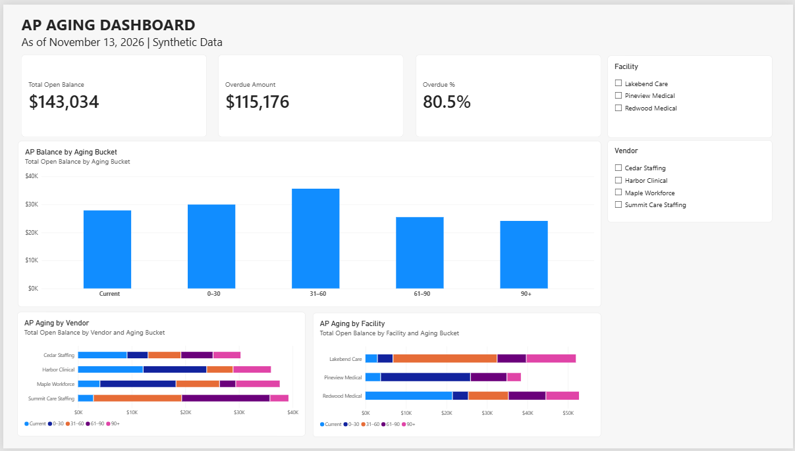

# AP Aging Dashboard — Power BI

## Overview

An interactive Power BI dashboard demonstrating accounts payable aging analysis for a healthcare staffing MSP/VMS business.

This project recreates a real-world financial reporting workflow originally developed to support CFO review of vendor payments and remittance documentation.

All data used in this demonstration is synthetic.

## Dashboard Preview



## Business Purpose

The dashboard provides visibility into outstanding vendor bills, overdue balances, and payment exposure across staffing agencies and healthcare facilities.

In a healthcare staffing MSP/VMS environment, approved agency invoices are linked to client billing. Understanding AP balances by facility helps support payment planning and further analysis of related client receivables.

## Key Performance Indicators

| KPI | Demo Result |
|---|---:|
| Total Open Balance | $143,034.38 |
| Overdue Amount | $115,175.63 |
| Overdue Percentage | 80.5% |

As of November 13, 2026.

## Dashboard Features

- Total outstanding AP balance
- Overdue amount and percentage
- AP balance by aging bucket
- Vendor-level aging analysis
- Facility-level aging analysis
- Interactive facility and vendor slicers
- Consistent chronological aging bucket order

## Data Source

The original business workflow uses a custom NetSuite Transaction Saved Search to extract detailed open vendor bill records.

The demonstration recreates that data structure using:

`AP_Open_Bills_Demo.csv`

The dataset contains 24 fictional open bills across four staffing agencies and three healthcare facilities.

Key fields include:

- Bill Date and Bill Number
- Vendor
- Due Date
- Work Week Ending (WEO)
- Memo
- Open Balance
- VMS Fee
- Gross Amount Before Fee
- Days Open
- Aging Bucket

The Memo preserves internal references, client invoice numbers, and facility information for downstream reporting.

## Data Transformation — Power Query

The Power Query workflow:

1. Imports the synthetic Saved Search CSV.
2. Assigns appropriate date, text, and numeric data types.
3. Preserves the original transaction memo.
4. Extracts Internal Reference, Client Invoice, and Facility from the memo.
5. Creates a numeric Aging Order column for chronological sorting.

Aging categories are displayed in the following order:

| Aging Bucket | Sort Order |
|---|---:|
| Current | 1 |
| 0–30 | 2 |
| 31–60 | 3 |
| 61–90 | 4 |
| 90+ | 5 |

## DAX Measures

### Total Open Balance

```dax
Total Open Balance =
SUM('AP_Open_Bills_Demo'[Open Balance])
```

### Overdue Amount

```dax
Overdue Amount =
CALCULATE(
    [Total Open Balance],
    'AP_Open_Bills_Demo'[Days Open] > 0
)
```

### Overdue Percentage

```dax
Overdue % =
DIVIDE(
    [Overdue Amount],
    [Total Open Balance],
    0
)
```

The measures respond dynamically to facility and vendor filters.

For this demonstration, Days Open represents the difference between the fixed reporting date and the due date. Bills due on the reporting date are treated as Current.

## How to Use

1. Download the Power BI file and sample CSV from this folder.
2. Open the PBIX file in Power BI Desktop.
3. Use the Facility and Vendor slicers to explore the dashboard.
4. To refresh the dataset, update the CSV source path in Power Query to the downloaded sample CSV.

Power BI Desktop is required for interactive use. The screenshot above provides a static preview for GitHub visitors.

## Connection to Accounting Automation

This dashboard complements the AR and AP automation projects in the main repository.

The AP automation prepares vendor bill records for accounting system import. The financial dashboard demonstrates how recorded accounting transactions can subsequently be extracted, transformed, and analyzed for management reporting.

The sample dashboard dataset is independently prepared and is not a live NetSuite connection or an automatically generated output of the AP automation demo.

## Technology

- Microsoft Power BI Desktop
- Power Query
- DAX
- CSV
- NetSuite Saved Search data structure

## Data Privacy

All vendors, facilities, invoice identifiers, and financial amounts in this demonstration are synthetic.

No production NetSuite connection, employer financial records, or confidential information is required.
