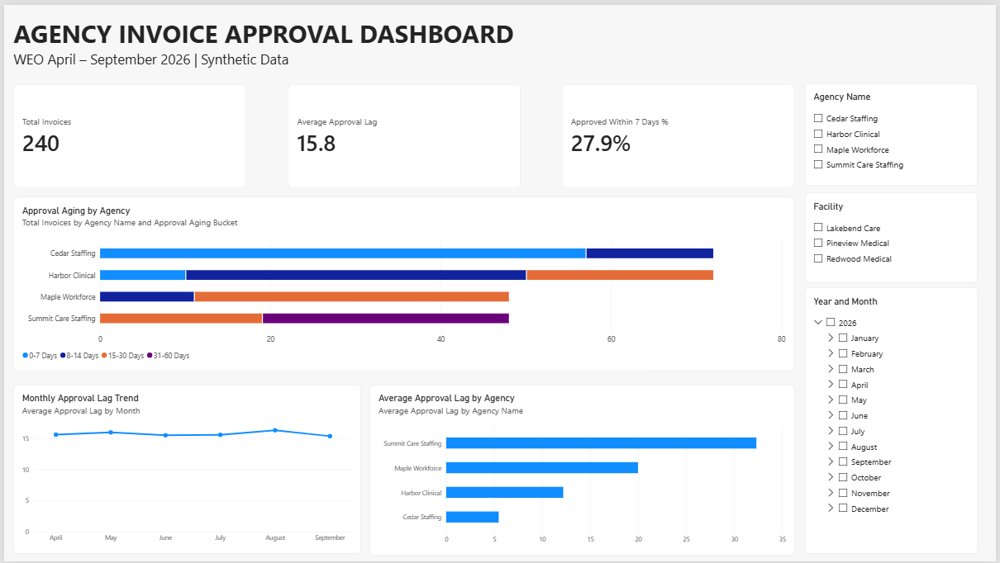

# Agency Invoice Approval Dashboard — Power BI

## Overview

An interactive Power BI dashboard analyzing the time required to approve staffing agency invoices after the work week ends.

This project recreates a real-world accounting analysis developed in a healthcare staffing MSP/VMS environment using entirely synthetic data.

## Dashboard Preview



## Business Context

In a healthcare staffing MSP/VMS business, approved agency invoices support downstream client billing.

Invoice approval delays may result from:

- Late initial invoice submissions
- Billing discrepancies requiring corrections
- Delayed responses to correction requests
- Extended review and approval cycles

These delays can affect client billing timelines, accounts receivable, and cash flow.

This dashboard helps identify patterns in approval turnaround times across agencies and facilities.

## Key Performance Indicators

| KPI | Demo Result |
|---|---:|
| Total Approved Invoices | 240 |
| Average Approval Lag | 15.8 days |
| Approved Within 7 Days | 27.9% |

WEO April – September 2026.

The seven-day threshold is an illustrative analytical benchmark, not a contractual requirement.

## Dashboard Features

### Approval Aging by Agency

The primary visualization combines invoice volume with approval aging distribution.

Each horizontal stacked bar represents the number of approved invoices, with colors showing how long approval took.

This makes it possible to distinguish high-volume agencies with fast approval cycles from lower-volume agencies with longer approval delays.

### Average Approval Lag by Agency

Compares average approval turnaround times across agencies.

### Monthly Approval Lag Trend

Shows changes in average approval lag by work week ending month.

### Interactive Filters

- Agency Name
- Facility
- Year and Month based on WEO

## Key Findings — Synthetic Data

- Cedar Staffing and Harbor Clinical have comparable invoice volumes, but Cedar has faster approval turnaround.
- Maple Workforce has fewer invoices but a longer approval cycle.
- Summit Care Staffing has the longest average approval lag, despite having fewer invoices than Cedar or Harbor.
- Higher invoice volume does not necessarily correspond to longer approval turnaround.
- The overall monthly average is relatively stable, while agency-level performance differs considerably.

These findings describe the synthetic demonstration dataset only.

## Data Source

The demonstration uses a fictional approved agency invoice dataset:

`Agency_Invoice_Approval_Demo.csv`

The dataset contains 240 invoices across four staffing agencies and three healthcare facilities.

### Source Fields

| Field | Description |
|---|---|
| Invoice Number | Agency invoice identifier |
| Agency Name | Staffing agency |
| Facility | Healthcare facility |
| WEO | Work week ending date |
| Approval Date | Date the invoice was approved |
| Total | Invoice amount |

## Data Transformation — Power Query

The Power Query workflow calculates approval lag, assigns aging categories, and creates a numeric sort order.

### Approval Lag

```powerquery
Duration.Days([Approval Date] - [WEO])
```

Lag Days represents elapsed calendar days between the work week ending date and invoice approval.

### Approval Aging Bucket

```powerquery
if [Lag Days] < 0 then "Review"
else if [Lag Days] <= 7 then "0-7 Days"
else if [Lag Days] <= 14 then "8-14 Days"
else if [Lag Days] <= 30 then "15-30 Days"
else if [Lag Days] <= 60 then "31-60 Days"
else if [Lag Days] <= 90 then "61-90 Days"
else "90+ Days"
```

### Aging Sort Order

| Approval Aging Bucket | Sort Order |
|---|---:|
| 0-7 Days | 1 |
| 8-14 Days | 2 |
| 15-30 Days | 3 |
| 31-60 Days | 4 |
| 61-90 Days | 5 |
| 90+ Days | 6 |

The aging structure supports longer approval delays, although the current demonstration dataset contains invoices within the first four categories.

## DAX Measures

### Total Invoices

```dax
Total Invoices =
COUNTROWS('Agency_Invoice_Approval_Demo')
```

### Average Approval Lag

```dax
Average Approval Lag =
AVERAGE('Agency_Invoice_Approval_Demo'[Lag Days])
```

### Approved Within 7 Days %

```dax
Approved Within 7 Days % =
DIVIDE(
    CALCULATE(
        [Total Invoices],
        'Agency_Invoice_Approval_Demo'[Lag Days] <= 7
    ),
    [Total Invoices],
    0
)
```

All measures respond dynamically to the report filters.

## Analytical Limitations

This dashboard analyzes approved invoices only.

Invoices that remain pending are not included in the average approval lag calculation. Consequently, the dashboard does not measure the full outstanding invoice backlog.

Approval lag includes the entire period from WEO to approval. Without separate submission, correction request, and resubmission dates, it cannot distinguish agency response delays from internal review time.

Additional event-level data would be required to analyze each stage of the invoice lifecycle.

## How to Use

1. Download the PBIX file and sample CSV.
2. Open the PBIX file in Power BI Desktop.
3. Use the Agency, Facility, and Year and Month slicers to explore the report.
4. To refresh the dataset, update the CSV source path in Power Query to the downloaded sample file.

The screenshot provides a static preview for GitHub visitors.

## Connection to Accounting Automation

This project complements the AR and AP automation workflows in the main portfolio.

While the automation projects demonstrate transaction preparation, validation, and reporting, this dashboard focuses on operational timing and invoice approval performance.

Together, the projects demonstrate how accounting data can support both transaction processing and management analysis.

## Technology

- Microsoft Power BI Desktop
- Power Query
- DAX
- CSV

## Data Privacy

All agency names, facility names, invoice identifiers, and financial amounts in this project are synthetic.

No employer financial records or live accounting system connections are required.
